<br />
<p align="center">
  <a href="https://replit-d.tw527e.eu.org" target="blank">
    
  </a>
  <h2 align="center" style="font-weight: 600">renexmoe-tw527e-edition</h2>

  <p align="center">
    高颜值 OneManager 主题
    <br /><br />
    <a href="README.md"></a>&nbsp;&nbsp;<a href="https://replit-d.tw527e.eu.org"></a>&nbsp;&nbsp;<a href="https://github.com/TW527E/renexmoe-tw527e-edition/releases/latest"></a>&nbsp;&nbsp;<a href="https://www.npmjs.com/package/renexmoe-tw527e-edition"></a>&nbsp;&nbsp;<a href="https://gitlab.com/TW527E/renexmoe-tw527e-edition/-/releases"></a>&nbsp;&nbsp;
    <a href="https://t.me/Cheng_Group"></a>
    <br />
    <br />
  </p>
</p>

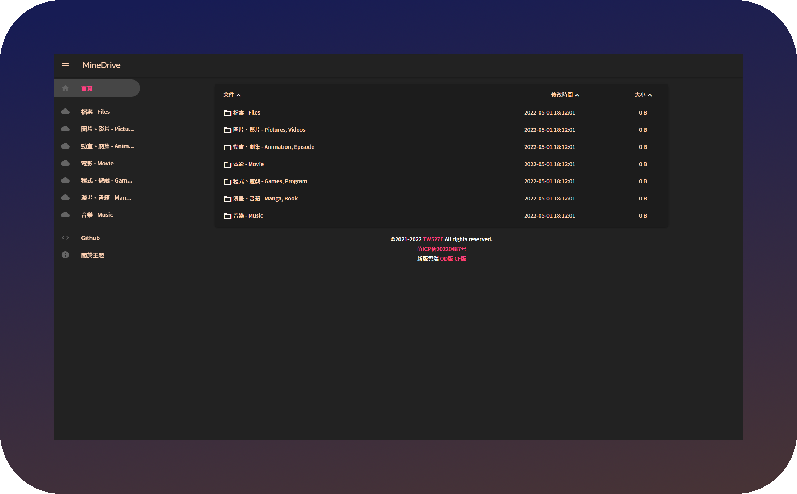

## ✨ 特性

- 🪵 增加 **`侧边栏`**
- 📟 增加 **`呼叫本地播放器`**
- ⏏️ 新增 **`页脚`**
- 📍 **`backgroundm`** 选项调用至 **`网页 Icon`**
- 🔲 增加 **`背景毛玻璃`**
- 🎨 **`主題颜色`** 调整为 **`奶茶色`**
- 📦 提供 **`多种`**  [**`CDN`**](releases) 选择，以及不经过 CDN 加载 JS / CSS 的 **`本地版`**
- 📺 **`影片播放器`** 更改为 [**`ArtPlayer`**](https://artplayer.org)
- 🎵 **`音频播放器`** 更改为 [**`APlayer`**](https://aplayer.js.org)
- 🕓 增加 **`自动恢复上次播放时间`**
- ⬆️ 增加 **`上传文件 / 文件夹`** (OneDrive / SharePoint)
- 📶 **`路径`** 显示于画面最上方


<Details>
<Summary>🛠️ 修改项目</Summary>
<Pre>

🔴 比较对象 [186526/onemanager-theme-renexmoe](https://github.com/186526/onemanager-theme-renexmoe)

- 🌏 将 **`语言`** 更改为 **`繁体中文`**
- 📍 将 **`backgroundm`** 选项内容调用至 **`网页 Icon`**
- 🔲 增加 **`背景毛玻璃`**
- 🎨 **`主题颜色`** 调整为 **`奶茶色`**
- 📜 修复 **`PDF 预览`**
- 📑 修复 **`OFFICE 预览排版`**
- 📦 提供 **`多种`**  [**`CDN`**](releases) 选择
- 📺 **`影片播放器`** 更改为 [ArtPlayer](https://artplayer.org)
- 🎵 **`音频播放器`** 更改为 [APlayer](https://aplayer.js.org)
- 🕓 增加 **`自动恢复上次播放时间`**
- 📟 增加 **`呼叫本地播放器`**
- ⬆️ 增加 **`上传文件 / 文件夹`**
- 🏠 增加不经过 CDN 加载 JS / CSS 的 **`本地版`**
- 🔗 修复 **`jsDelivr / Statically 版本资源 404`**
- 🔠 将 **`字体`** 更改为 [Noto Sans TC SC HK](https://fonts.google.com/noto/fonts)
- ⏏️ 新增 **`页脚`**
- 📶 修复 **`路径未显示盘名`**
- 📲 修复 **`登入按鈕`**

</Pre>
</Details>


## 📚 使用方法

此版本由 [@TW527E](https://github.com/TW527E) 维护，作用于 [OneManager-php](https://github.com/qkqpttgf/OneManager-php)

访问此项目的 [Releases](releases) 页面下载主题文件

### ✅ 1: 下载至目录

1. 下载 [**`renexmoe-tw527e-edition`**](https://github.com/TW527E/renexmoe-tw527e-edition/releases)
2. 将 **`renexmoe-tw527e-edition.html`** 复制至 **`/OneManager 根目錄/theme`**

### 🔧 2: 使用我的 OneManager-php

1. 登录您的 OneManager 后台，并进入设置
2. 选择 **`首页`** 页面
3. 在 **`Update from`** 选择 `GitHub` `TW527E` `OneManager-php` `master`
4. 点击 **`一鍵更新`**
5. 等待更新，完成

### 🍄 3: 通过 customTheme 选项 (等待 🍄 修复ww)

1. 登入您的 OneManager 后台，并进入设置
2. 选择 **`平台变量`** 页面
3. 在 **`customTheme`** 选项内，输入 **`以下几个cdn中的其中一个`**
- (UNPKG: **`https://unpkg.com/renexmoe-tw527e-edition@latest/renexmoe-tw527e-edition.html`**)
- (饿了么 CDN: **`https://npm.elemecdn.com/renexmoe-tw527e-edition@latest/renexmoe-tw527e-edition-elemecdn.html`**)
- (Statically: **`https://raw.githubusercontent.com/TW527E/renexmoe-tw527e-edition/master/renexmoe-tw527e-edition-statically.html`**)
- (JsDelivr CDN: **`https://cdn.jsdelivr.net/gh/TW527E/renexmoe-tw527e-edition@latest/renexmoe-tw527e-edition-jsdelivr-cdn.html`**)
- (JsDelivr Fastly: **`https://fastly.jsdelivr.net/gh/TW527E/renexmoe-tw527e-edition@latest/renexmoe-tw527e-edition-jsdelivr-fastly.html`**)
- (JsDelivr Gcore: **`https://gcore.jsdelivr.net/gh/TW527E/renexmoe-tw527e-edition@latest/renexmoe-tw527e-edition-jsdelivr-gcore.html`**)
- (JsDelivr OriginFastly: **`https://originfastly.jsdelivr.net/gh/TW527E/renexmoe-tw527e-edition@latest/renexmoe-tw527e-edition-jsdelivr-originfastly.html`**)
4. 套用设置
5. 等待缓存刷新，完成

### 🏠 4: 本地版 (JS / CSS 不经过 CDN)

OneManager 会把所有网址都交给 `index.php` 处理，主题没办法直接读取同目录的文件，只能通过 OneManager 内置的 `?jsFile=` 读取 **`OneManager 根目录/js`** 里的 `.js` 文件，所以本地版把 CSS 也打包成了 JS。

1. 下载本项目的 **`local`** 文件夹与 **`renexmoe-tw527e-edition-local.html`**
2. 将 **`local`** 文件夹内的所有 `.js` 文件复制至 **`/OneManager 根目录/js`** (与 `sha1.min.js` 等文件放在一起，不要建立子文件夹)
3. 将 **`renexmoe-tw527e-edition-local.html`** 复制至 **`/OneManager 根目录/theme`**，并在设置中选择此主题
- 字体与 PDF 的 cMap 不是 `.js` 文件，仍会从 unpkg 加载；连不上时会改用系统字体，不影响使用
- Vercel 等通过 Git 部署的平台，需要把这些文件一起加进部署的代码中

### ⬆️ 上传文件

- 管理员登录后，文件夹页面上方会出现上传区块，可上传文件或整个文件夹
- 在 OneManager 设置 **`guestup_path`** 后，访客可以在该目录上传 (文件名会由 OneManager 改为文件的 MD5)
- 目前只支持 **`OneDrive / SharePoint`** (含世纪互联)，其他网盘会显示不支持
- 大于 10MB 的文件中断后，重新选择同一个文件上传即可从上次的位置继续


## 🔧 主題设置

<Details>
<Summary>🔲 背景毛玻璃</Summary>
<Pre>

1. 登入您的 OneManager 后台，并进入设置
2. 选择 **`平台变量`** 页面
3. 在 **`customScript`** 选项内，输入 **`<script>document.querySelector('.blur').style = "backdrop-filter: blur(2px); -webkit-backdrop-filter: blur(2px)"</script>`**
- (可自行调整数字 "2" 的大小，越大越模糊，越小越清楚)
4. 套用设置
5. 等待缓存刷新，完成 **`(请等待至少30分钟，使customScript选项生效)`**
</Pre>
</Details>

<Details>
<Summary>⏏️ 页脚</Summary>
<Pre>

1. 登入您的 OneManager 后台，并进入设置
2. 选择 **`平台变量`** 页面
3. 在 **`customScript`** 选择内，输入 **`<script>document.getElementById("footer").innerHTML='頁腳內容';</script>`**
4. 套用设置
5. 等待缓存刷新，完成 **`(请等待至少30分钟，使customScript选项生效)`**
</Pre>
</Details>


## 🧿 已知问题

<Details>
<Summary><strong><code>音乐播放器</code></strong> 在部分种类云端会触发防盗链，已将备用方案设为恢复原本播放器</Summary>
<Pre> 
已知：

- [x] 🟧 **`阿里云盘`**
</Pre>
</Details>

<Details>
<Summary><strong><code>iOS</code></strong> 在部分内容支持不佳或处理速度异常</Summary>
<Pre>
已知：

- 🎵 **`音乐播放器`**: 在不特定的情況下，因连结跳转 iOS 拒绝存取
- 📺 **`影片播放器`**: 在尚未快取完成时，就开始播放，导致看起來好像已经开始播放，却无画面，直到快取完成时，才重新播放
- 🔳 **`背景圖片`**: 在众多文件的页面中，背景会被拉长 [Safari Bug 219324](https://webkit.org/b/219324)
</Pre>
</Details>


## 🧑‍💻 开发

所有主题 HTML 都由 **`src/renexmoe-tw527e-edition.html`** 生成，请修改这个文件后运行 (需要 Node.js 18 以上)：

```
npm run build
```

会重新生成各 CDN 版本、本地版 HTML 与 **`local`** 文件夹。第一次运行会下载本地版需要的第三方包，之后使用 **`.cache`** 内的缓存。


## 📜 开源协议

依据源仓库之开源协议，本仓库采用 [GPL-3.0 协议](https://spdx.org/licenses/GPL-3.0-only.html)进行开源


## 🔴 灵感来源

源代码来自 [186526/onemanager-theme-renexmoe](https://github.com/186526/onemanager-theme-renexmoe)

此版本修改来自 [jssycszyj/renexmoe-cdn](https://github.com/jssycszyj/renexmoe-cdn)

Readme 写法及图片做法来自 [qier222/YesPlayMusic](https://github.com/qier222/YesPlayMusic)

- [qkqpttgf/OneManager-php](https://github.com/qkqpttgf/OneManager-php)

- [zdhxiong/mdui](https://github.com/zdhxiong/mdui)

- [zhw2590582/ArtPlayer](https://github.com/zhw2590582/ArtPlayer)

- [DIYgod/APlayer](https://github.com/DIYgod/APlayer)

- [aadsm/jsmediatags](https://github.com/aadsm/jsmediatags)

- [Xhofe/alist](https://github.com/Xhofe/alist)

- [mjackson/unpkg](https://github.com/mjackson/unpkg)

- [fontsource/fontsource](https://github.com/fontsource/fontsource)

- [highlightjs/cdn-release](https://github.com/highlightjs/cdn-release)

- [mozilla/pdf.js](https://github.com/mozilla/pdf.js)

- [linkgod/SHA-1](https://github.com/linkgod/SHA-1)


## 🎗️ 支持我

目前可以以下列方式支持我

- ⭐ Star 这个仓库
- 🔌 Fork 这个仓库
- 👥 <a href="https://t.me/Cheng_Group">加入 Telegram 群组</a>
- 🔴 目前还无法通过赞助的方式支持我 `(未成年又没有银行账户w)`


## 🖼️ 截图 `(v1.0.22)`

<Details>
<Summary>💻 电脑</Summary>
<Pre>


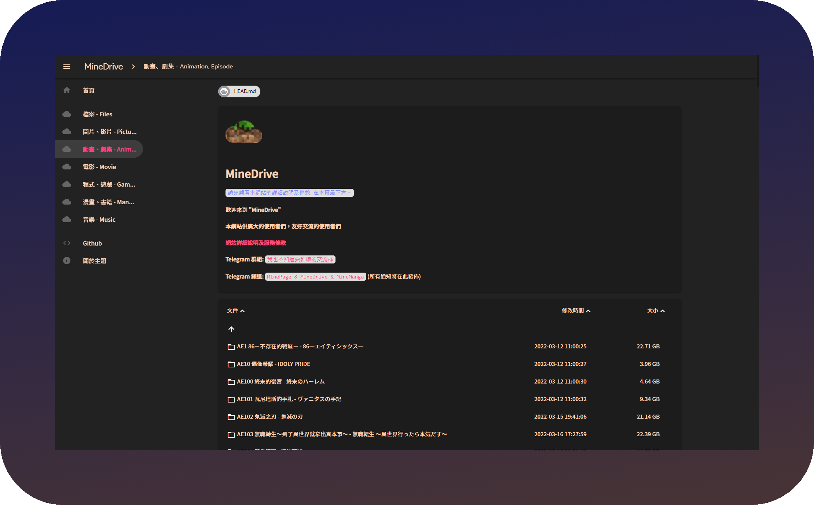
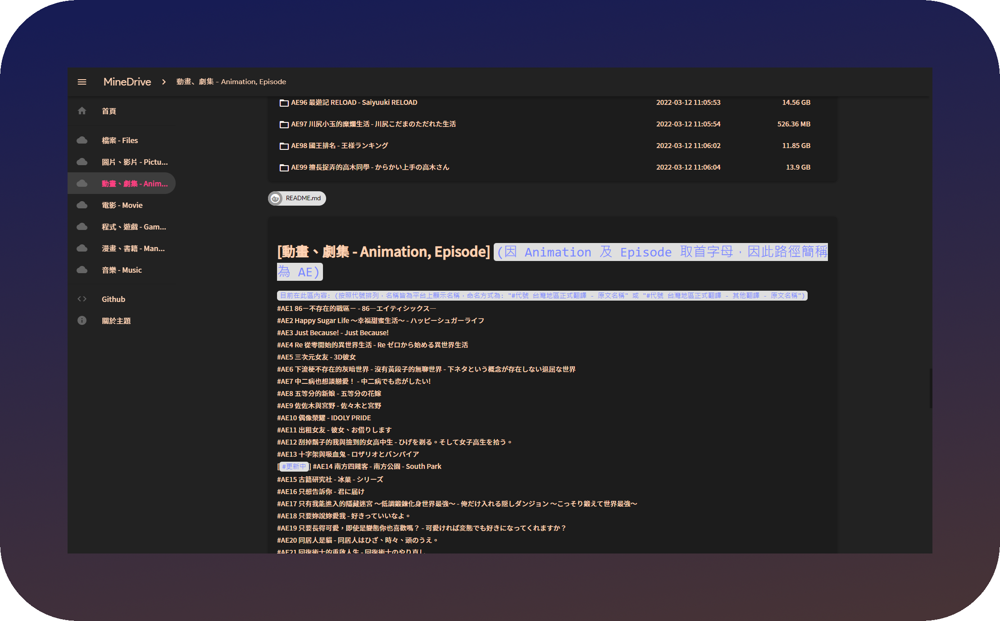
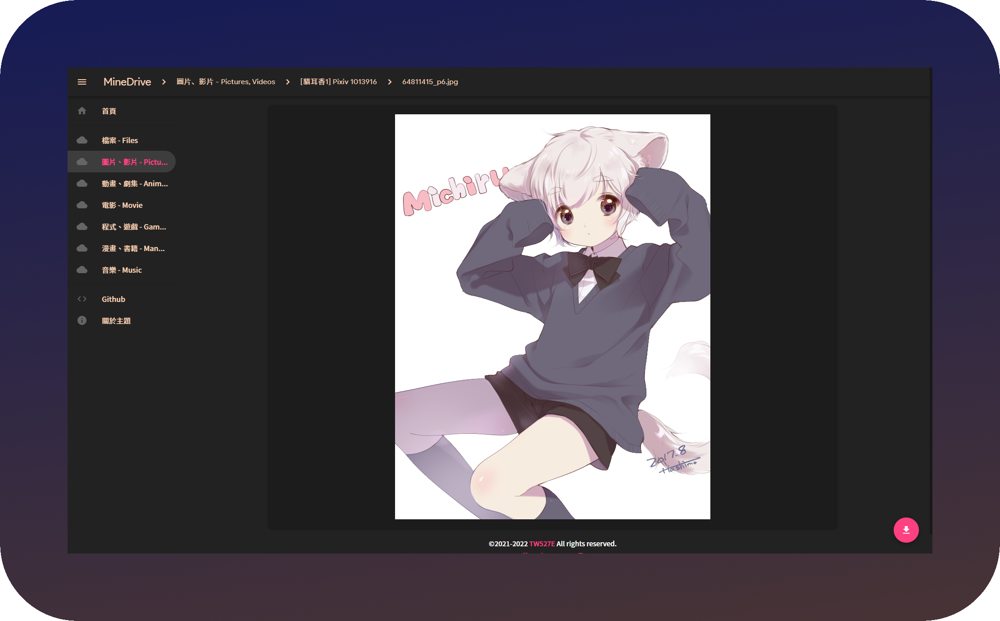
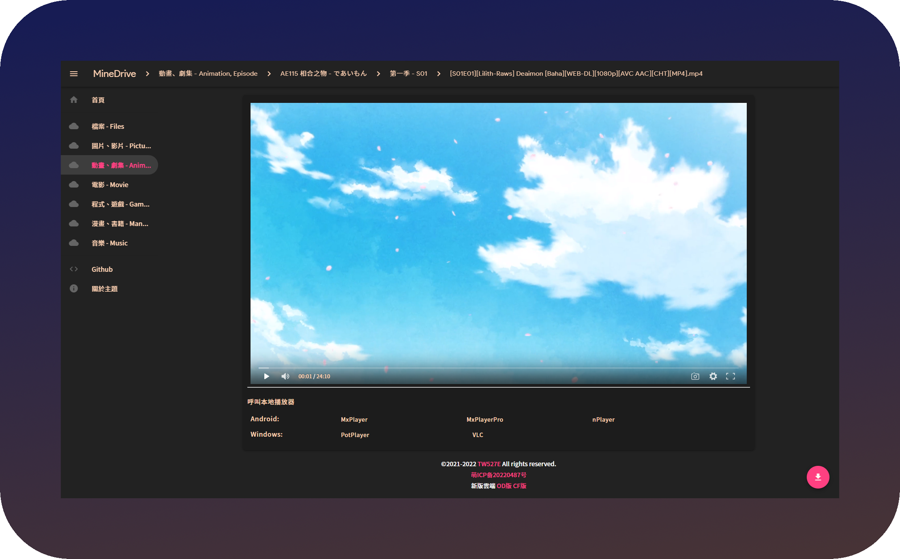
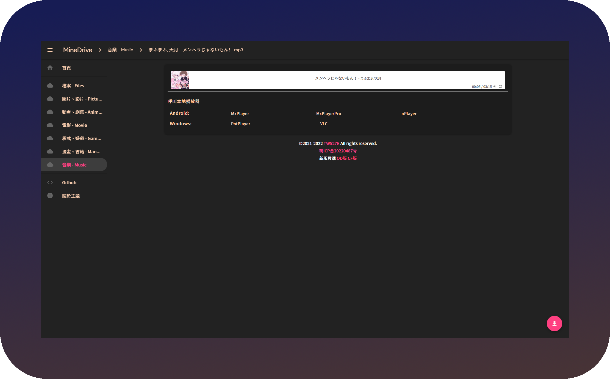
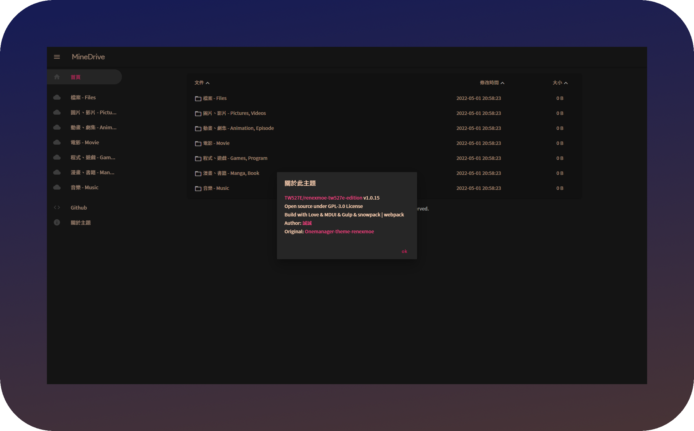

</Pre>
</Details>

<Details>
<Summary>📱 手机</Summary>
<Pre>

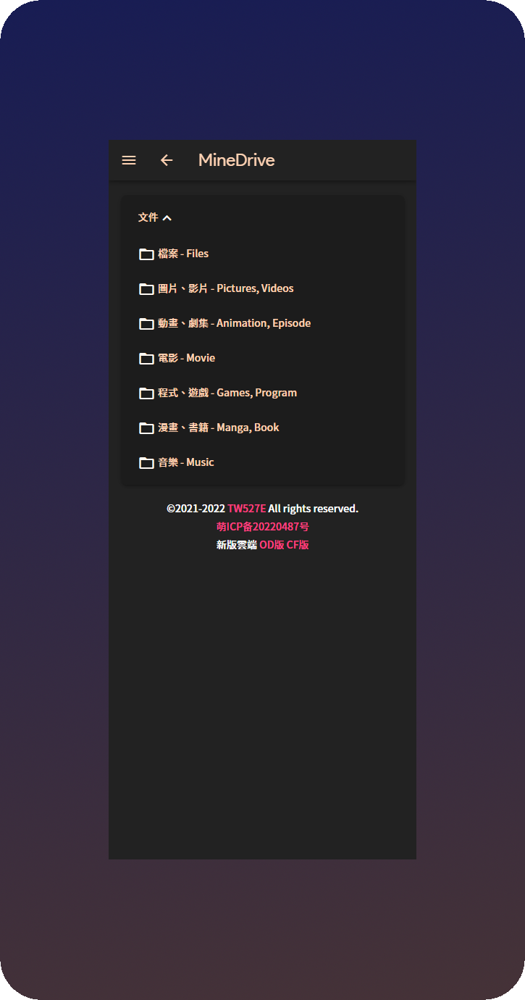
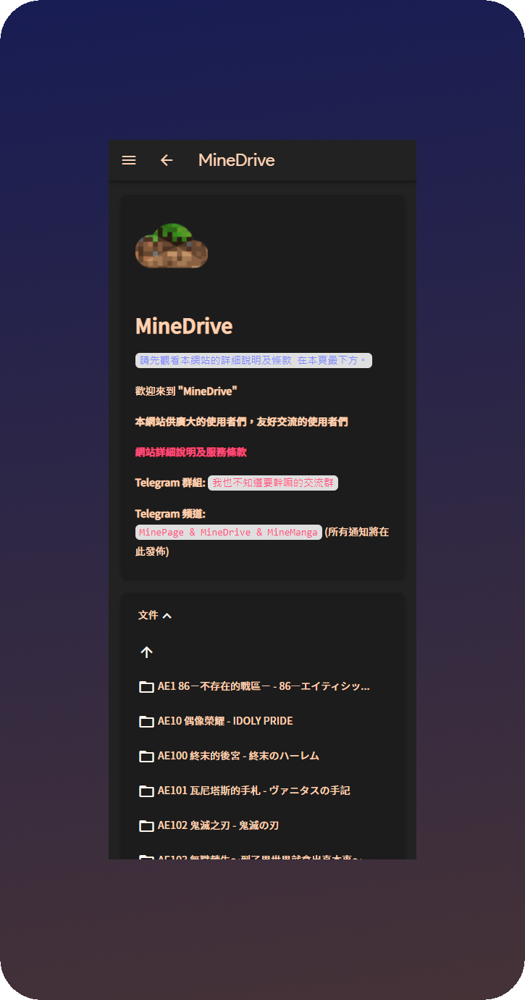
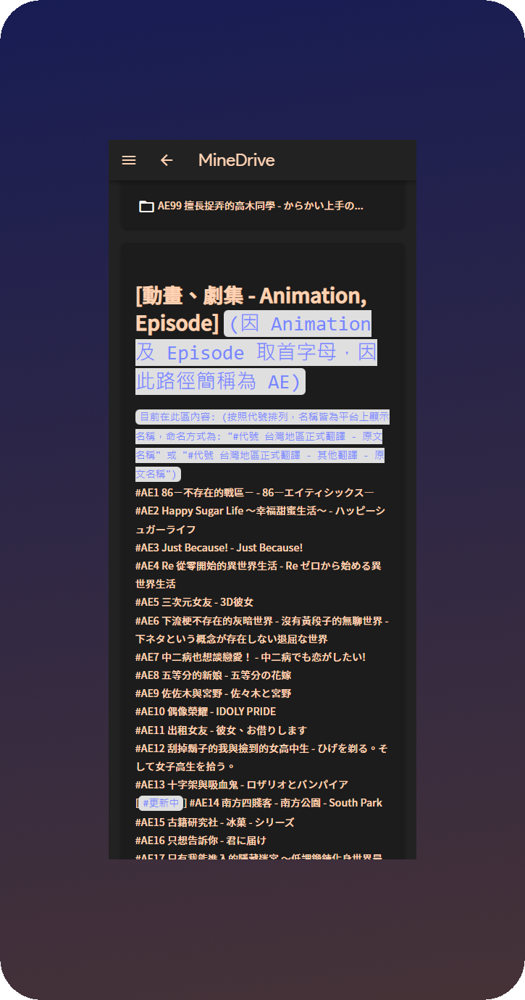
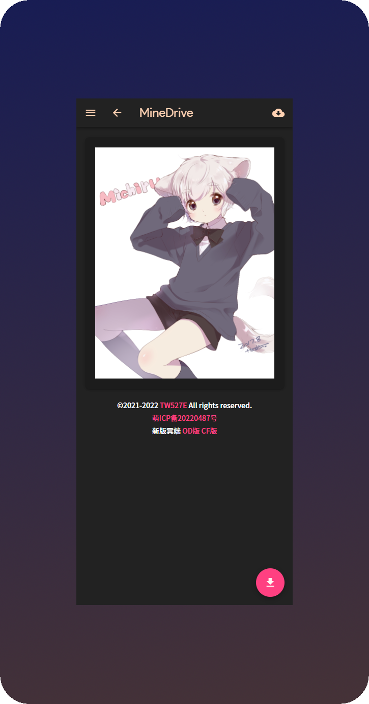
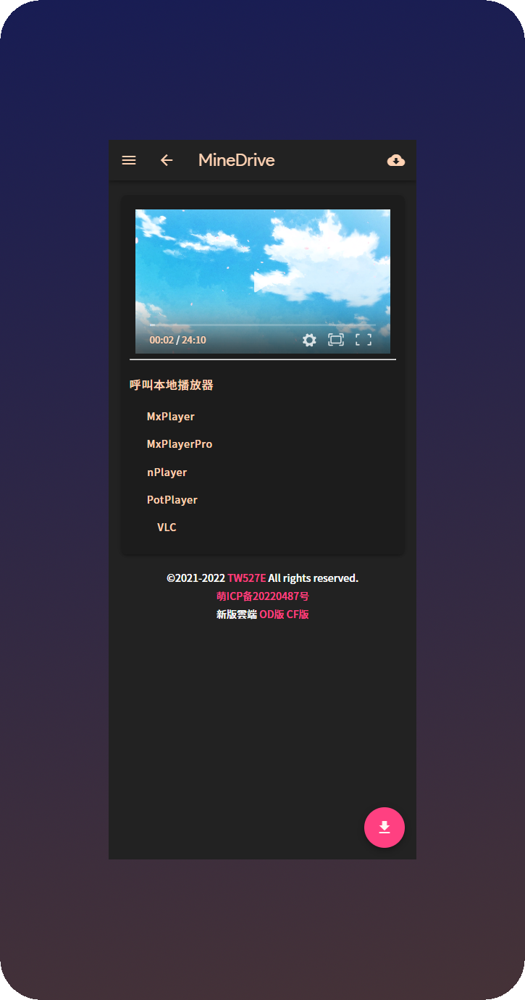
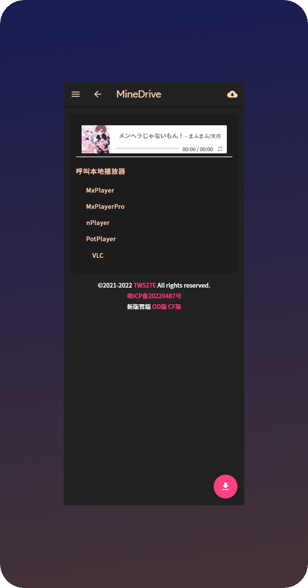
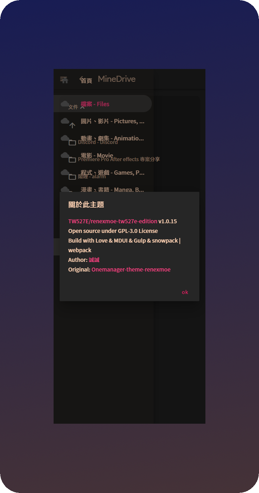
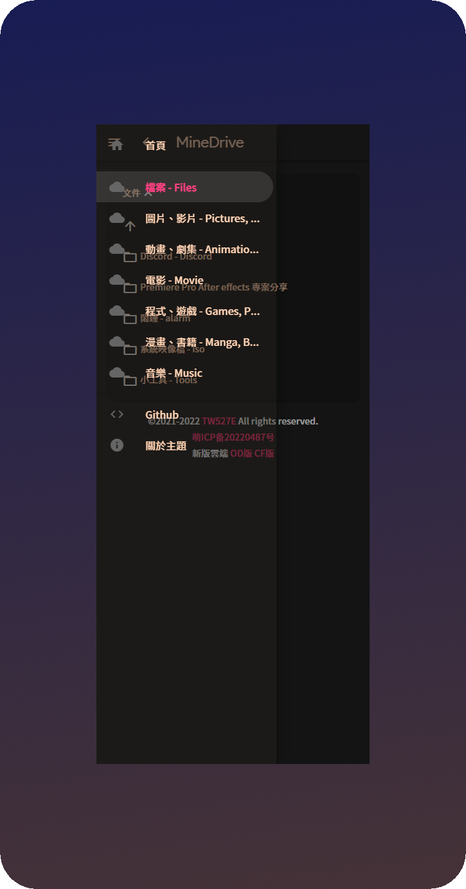

</Pre>
</Details>
